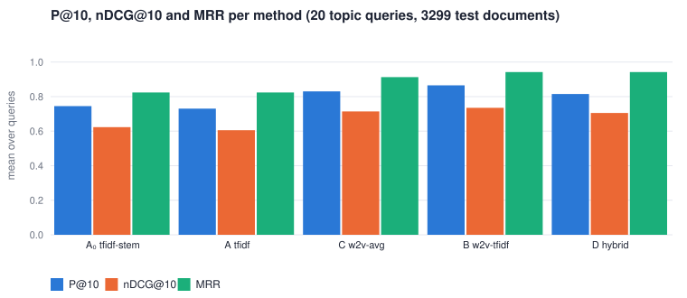
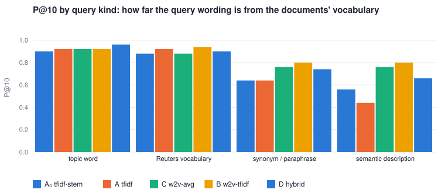
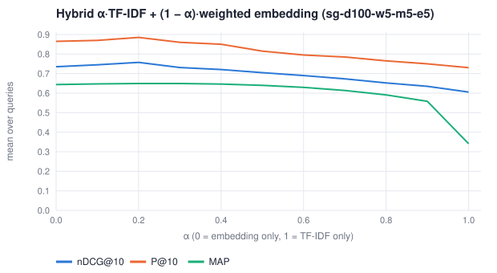

# Project #4 — Reuters-21578：從 TF-IDF 到 Word Embedding 的新聞檢索實驗

作者：胡元楨（P77141105）　課程：AI Information Retrieval（人工智慧資訊檢索）　繳交：2026-11-10

所有程式皆為純 Python 3 標準函式庫自行實作：`ir/reuters.py`（SGML 解析、ModApte 切分、主題相關性）、`ir/embedding.py`（詞向量文件表示、融合、共現統計）、
沿用 Project #2 的 `ir/word2vec.py`（skip-gram / CBOW）與 Project #3 的 `ir/tfidf.py`、`ir/evaluation.py`；前端 `static/embed.js`（分頁「Word Embedding 檢索」，`/#emb`）；CLI `python3 cli.py reuters …`。
文中每個數字都可由 CLI 重現（指令附在各節），單元測試在 `tests/test_project4.py`（19 個測試）。

**一句話結論。** 在 Reuters-21578 的 20 個主題查詢上，TF-IDF 加權的詞向量平均（方法 B，skip-gram d100）把 P@10 從 0.730 提高到 0.865、MRR 0.824 → 0.942、nDCG@10 0.605 → 0.735；
但收益幾乎全部來自「查詢用字與新聞用字不同」的查詢（同義／改寫、情境描述），在主題詞查詢上兩者打平；CBOW 的收益只有 skip-gram 的一半；
不加權的詞向量平均（C）比 B 差；TF-IDF 與 B 的分數融合（D）在 α = 0.2 時最佳（nDCG@10 0.757），但在預設 α = 0.5 時反而比 B 差。詞向量相近不代表同義（profit / loss cosine 0.79，rise / fall 0.87）。

---

## 0. 資料集：Reuters-21578 ModApte

| 項目 | 數值 |
|---|---|
| 來源 | Reuters-21578, Distribution 1.0（Lewis；`reuters21578.tar.gz`，22 個 SGML 檔 reut2-000 … 021，21,578 則 1987 年路透新聞） |
| 解析 | `ir/reuters.py`：Latin-1 解碼、SGML 實體（`&lt;` `&amp;` `&#3;`）、移除控制字元與結尾 "Reuter" 署名、把硬換行的段落接回完整句子（段首四個空白 = 新段落）；1.1 s |
| ModApte | `TOPICS="YES"` 且 `LEWISSPLIT` = TRAIN / TEST：**train 9,603、test 3,299**，共 12,902（其餘 8,676 不用）；118 個不同主題；2,108 篇 TOPICS=YES 但沒有任何主題；1,063 篇 BRIEF 只有標題 |
| 角色 | train = word2vec 訓練文字（68,063 句、763,173 詞元；29,660 詞型，min_count 5 後 **9,996**）；test = 檢索集合（384,126 詞元 → 245,784 索引詞，每篇 5–778、平均 74.5；詞彙 17,295，其中 8,494 只出現一次） |
| 檔案 | `data/reuters/reuters_modapte.jsonl`（newid、split、topics、places、title、body 段落、date） |

| topic | 說明 | 全部 | train | test | test 中「唯一主題」 |
|---|---|---:|---:|---:|---:|
| earn | 企業獲利與財務結果 | 3,964 | 2,877 | 1,087 | 1,083 |
| acq | 企業收購與併購 | 2,369 | 1,650 | 719 | 696 |
| crude | 原油 | 578 | 389 | 189 | 121 |
| grain | 穀物 | 582 | 433 | 149 | 10 |
| trade | 國際貿易 | 487 | 369 | 117 | 75 |

`python3 cli.py reuters build <dir>`、`python3 cli.py reuters info`

**相關性判斷。** 每個查詢針對一個主題；test 文件帶該主題即相關：grade 2 = 該主題是文件唯一的主題（新聞「就是在講」這件事），grade 1 = 多個主題之一，0 = 無。
TOPICS 由路透與 Carnegie Group 的編目員在 1987 年人工指派，與查詢文字和任何檢索方法無關，所以判斷不偏向 TF-IDF 或詞向量。grain 新聞幾乎都同時帶 wheat / corn 子主題，所以 grade 2 只有 10 篇。

---

## 任務一：TF、DF、IDF、TF-IDF 與 cosine

沿用 Project #3 的向量空間模型（`ir/tfidf.py`）：tf(t,d)、df(t)、idf = ln(N/df)、`ltc` 權重 (1 + ln tf)·idf 後 L2 正規化，分數 = 查詢向量 · 文件向量 = cosine。
為了讓 TF-IDF 與詞向量用**完全相同的詞**，`ir/embedding.py: WordTokenizer` 把 word2vec 的前處理（小寫、移除停用詞、保留連字號詞、丟掉純數字、**不做 stemming**）接到同一個 `VectorSpace`；
Porter stemming 的 TF-IDF（Project #3 的管線）另列為 A₀ 對照。

test 集合 df 最高的詞：said 2,026、mln 1,609、dlrs 1,451、net 988、pct 971、vs 966、cts 960、inc 931、shr 880、corp 839、qtr 815、year 797、company 774。
它們在 3,299 篇中出現於四分之一到六成，idf 只有 0.5–1.4；而 petroleum（df 90）、output（df 92）、production（df 180）的 idf 是 3.6、3.6、2.9。

---

## 任務二：Word2Vec（CBOW 與 skip-gram）

`ir/word2vec.py`（Project #2 的實作：negative sampling 5、dynamic window、sub-sampling 1e-3、線性遞減學習率）在 **train 切分**上訓練；模型存為 `data/reuters/w2v/<name>.json`，六個隨程式附上：

| 模型 | 架構 | dim | window | epochs | 詞彙 | final loss | 訓練時間（純 Python） |
|---|---|---:|---:|---:|---:|---:|---:|
| **sg-d100-w5-m5-e5** | skip-gram | 100 | 5 | 5 | 9,996 | 2.117 | 21.3 min |
| **cbow-d100-w5-m5-e5** | CBOW | 100 | 5 | 5 | 9,996 | 1.951 | 6.7 min |
| sg-d50-w5-m5-e5 | skip-gram | 50 | 5 | 5 | 9,996 | 2.141 | 11.5 min |
| cbow-d50-w5-m5-e5 | CBOW | 50 | 5 | 5 | 9,996 | 1.947 | 3.5 min |
| sg-d100-w2-m5-e5 | skip-gram | 100 | 2 | 5 | 9,996 | 2.054 | 13.3 min |
| cbow-d100-w5-m5-e10 | CBOW | 100 | 5 | 10 | 9,996 | 1.647 | 13.5 min |

loss 是每個訓練樣本的平均 negative-sampling loss；skip-gram 的樣本是（中心詞 → 一個上下文詞），CBOW 是（上下文平均 → 中心詞），所以 loss 不能跨架構比較。
粗體兩個是後文的主要模型。**覆蓋率**：9,996 個詞只覆蓋 test 詞彙 17,295 個詞型的 46.0%，但覆蓋 93.0% 的詞元（未覆蓋的多是公司名、人名與只出現一次的詞）；沒有任何一篇 test 文件完全沒有向量。
`python3 cli.py reuters train --model sg --dim 100 --epochs 5`、`python3 cli.py reuters models`

---

## 任務三：Word-level — 每個詞的 Top-5 最近鄰

每個鄰近詞另附兩個證據：**同篇** = 兩詞在 train 集合中共同出現的文件數（與文件層級 PMI），**主題** = test 集合中含該鄰近詞的文件最常帶的主題。`python3 cli.py reuters similar oil petroleum … --models sg-d100-w5-m5-e5,cbow-d100-w5-m5-e5`

| 詞 | skip-gram d100：Top-5（cos） | CBOW d100：Top-5（cos） | 兩模型共同 |
|---|---|---|---:|
| oil | crude .74, gas .69, petroleum .64, pipeline .62, natural .61 | crude .80, natural .80, fuel .76, pipeline .76, postings .76 | 3 |
| crude | crudes .81, api .79, barrel .78, postings .78, bbls .76 | postings .92, fuel .90, gasoline .90, barrels .87, bpd .87 | 1 |
| opec | bpd .78, lukman .77, nazer .77, arabia .77, ceiling .76 | producer .90, colombia .86, arabia .85, import .85, coffee .84 | 1 |
| petroleum | king .70, xon .69, esso .69, gas .68, inland .68 | mines .92, columbia .86, mining .84, pty .84, pacific .83 | 0 |
| profit | loss .79, oper .78, pre-tax .77, profits .75, comalco .75 | pre-tax .88, loss .86, profits .85, pretax .83, attributable .82 | 3 |
| loss | oper .89, yr-ago .84, varity .84, carryforwards .83, carryforward .83 | extraordinary .91, pretax .90, oper .90, gain .88, excludes .88 | 1 |
| earnings | revenues .77, profits .77, income .76, results .74, after-tax .72 | operating .87, results .86, revenues .85, losses .82, after-tax .82 | 3 |
| acquisition | transaction .77, merger .76, buyout .72, acquisitions .71, comdata .70 | buyout .92, lbo .87, merger .87, borg-warner .86, leveraged .86 | 2 |
| takeover | hostile .84, buyout .79, icahn .78, unsolicited .78, cyacq .77 | cyacq .91, gencorp .90, buyout .90, unsolicited .90, gaf .89 | 3 |
| grain | corn .77, wheat .77, cotton .72, feed .71, soybeans .71 | soybeans .93, winter .93, corn .92, feed .92, grains .92 | 3 |
| wheat | soybeans .81, rice .78, barley .78, feed .78, grains .78 | corn .94, barley .93, soybeans .92, malt .90, maize .89 | 2 |
| cereal（count 24） | grants .92, bread .89, spanish .89, non-ec .89, levies .88 | availability .95, ghana .95, fixing .95, featured .95, artificially .94 | 0 |
| trade | yeutter .64, gatt .62, surpluses .61, tariffs .60, bilateral .60 | tariffs .71, taiwan .67, bilateral .67, korea .67, yeutter .66 | 3 |
| tariff（count 38） | implemented .84, trigger .83, slash .83, levies .82, anti-dumping .82 | lull .96, non-opec .95, harmful .95, pakistani .95, protests .94 | 0 |
| deficit | surplus .86, deficits .78, widened .74, narrowed .74, invisibles .73 | surplus .96, balance .84, account .83, invisibles .82, narrowed .82 | 3 |

**(1) 合理的語意／用法關係。** oil–crude–petroleum–gas、grain–corn–wheat–soybeans、wheat–barley–maize–rice、acquisition–merger–buyout–transaction、deficit–surplus–deficits、earnings–revenues–profits–income：同一個語意場的詞在相同句型中互換出現（"X output rose"、"Y crop estimated"、"agreed to acquire / merge"），向量自然靠近。
詞形變化（crude / crudes、profit / profits、deficit / deficits、grain / grains）也靠近——這是 stemming 用規則做、詞向量用上下文學到的同一件事。

**(2) 因為常出現在相似新聞情境而接近。** opec 的鄰近詞 lukman、nazer（OPEC 官員）、arabia、ceiling、bpd：它們不是 opec 的同義詞，而是同一類「OPEC 產量」新聞的固定班底（同篇 6–42 篇、PMI 3.8–4.7）。
takeover–hostile–icahn–unsolicited、acquisition–borg-warner、grain–winter（winter wheat）、trade–yeutter–gatt–korea–taiwan 都是這類：共現證據（同篇、PMI 高）而非語意等同。
最重要的例子是 **profit–loss（cos 0.79 / 0.86，同篇 569）、rise–fall（0.87 / 0.92）、buy–sell（0.77）**：反義詞在財經新聞裡佔據完全相同的句位（"net profit/loss of X mln"、"prices rose/fell"），向量只知道「用法相同」，不知道「意思相反」。

**(3) 不符合預期的結果與原因。**
* **petroleum**：預期鄰近 oil、crude，實際 skip-gram 給 king、xon、esso、inland，CBOW 給 mines、columbia、mining、pty、pacific。原因：在路透語料裡 petroleum 大多是**公司名的一部分**（British Petroleum、Pacific Petroleum、Esso Petroleum、Columbia Petroleum…）；含 petroleum 的 test 文件只有 44% 是 crude，29% 是 acq（併購新聞）。向量學到的是「這個詞在語料中的上下文」，而 petroleum 的上下文是公司名與併購。
* **cereal、tariff**：訓練次數只有 24 與 38，鄰近詞是 grants、spanish、ghana、lull、harmful 這類看不出關係的詞，且 cosine 反而極高（0.88–0.96）——稀有詞的向量只被更新了幾十次，仍接近隨機初始化附近的「低頻詞聚落」；兩模型的 Top-5 完全不重疊，說明它們不穩定。
* **loss**（skip-gram）：yr-ago、varity、carryforwards 是損益表的格式詞與一家公司名（Varity 連續虧損），同篇數低但 PMI 高——小語料中少數幾篇新聞就能決定一個詞的鄰居。
* **CBOW 的 cosine 普遍高於 skip-gram**（0.85–0.95 vs 0.60–0.80），且 opec–coffee（同篇 0）、wheat–malt 這類無關鄰居較多：CBOW 用上下文平均預測中心詞，向量較平滑、彼此更靠近，分辨力較低。

> 向量相近 ≠ 同義。上表每一列都同時含有同義詞、同情境詞與反義詞，所以 word-level 的相似度只能說明「哪些詞常在相同語境出現」，不能直接推論「用這些詞去檢索會找到同一批文件」——那是任務五要回答的問題。

---

## 任務四：用詞向量表示文件

同一組詞、同一個 cosine 排序下的四種表示（`ir/embedding.py`）：

| 代號 | 方法 | 文件／查詢向量 |
|---|---|---|
| A₀ | TF-IDF · Porter stems | Project #3 的 `ltc`（對照） |
| **A** | TF-IDF · surface words | w(t) = (1 + ln tf)·ln(N/df)，L2 正規化；只有詞彙匹配 |
| C | 詞向量平均 | d = Σ_t tf·v_t / Σ tf，再 L2 正規化（每個詞元一票） |
| **B** | TF-IDF 加權詞向量平均 | d = Σ_t (1 + ln tf)·idf(t)·v_t / Σ w，再 L2 正規化 |
| D | 融合 | score = α·cos_A + (1 − α)·cos_B，兩邊都沒有正分的文件不檢回 |

B 保留 TF-IDF 對重要詞的辨識力（said、mln、dlrs 幾乎沒有權重），又用詞向量帶進上下文關係（petroleum 的向量靠近 oil、gas）。不在詞彙中的詞（OOV）跳過；查詢全是 OOV 時回傳空排名。
3,299 篇的文件向量每個模型、每個方法建一次（約 1.3 s），之後每次查詢 10–20 ms。

---

## 任務五：檢索系統與評估

20 個查詢 = 5 個主題 × 4 種用字；相關集 = test 中帶該主題的新聞。指標 P@5、P@10、R@10、MRR、MAP、nDCG@10（graded，log₂ 折扣）、nDCG@20。`python3 cli.py reuters queries`、`python3 cli.py reuters eval --models sg-d100-w5-m5-e5,cbow-d100-w5-m5-e5`

| 種類 | 意思 | earn | acq | crude | grain | trade |
|---|---|---|---|---|---|---|
| topic 主題詞 | 直接用主題詞 | quarterly net profit results | acquisition of a company | crude oil prices | grain exports | international trade dispute |
| domain 路透慣用詞 | 新聞裡的行話 | company reports earnings per share | takeover bid for shares | OPEC barrel output quota | wheat and corn harvest | trade deficit and surplus |
| synonym 同義／改寫 | 換掉主題詞 | corporate financial performance for the year | merger agreement between two firms | **petroleum** production and output | **cereal** crop production forecast | import tariffs and export restrictions |
| semantic 情境描述 | 幾乎不含主題詞 | income statement with revenue and sales figures | buying a controlling stake in a business | energy exploration and drilling | agriculture department crop report | protectionism and talks between countries |

### 5.1 主結果（20 個查詢的平均）

| run | P@5 | P@10 | R@10 | MRR | MAP | nDCG@10 | nDCG@20 |
|---|---:|---:|---:|---:|---:|---:|---:|
| A₀ TF-IDF stems | 0.730 | 0.745 | 0.032 | 0.824 | 0.369 | 0.623 | 0.654 |
| **A TF-IDF** | 0.750 | 0.730 | 0.032 | 0.824 | 0.341 | 0.605 | 0.630 |
| C 平均 · CBOW d100 | 0.720 | 0.755 | 0.031 | 0.762 | 0.610 | 0.630 | 0.655 |
| C 平均 · skip-gram d100 | 0.830 | 0.830 | 0.035 | 0.912 | 0.638 | 0.714 | 0.714 |
| B 加權 · CBOW d100 | 0.780 | 0.790 | 0.032 | 0.870 | 0.605 | 0.670 | 0.670 |
| **B 加權 · skip-gram d100** | **0.900** | 0.865 | 0.037 | 0.942 | 0.644 | 0.735 | 0.738 |
| D 融合 α = 0.5 · CBOW d100 | 0.820 | 0.810 | 0.034 | 0.843 | 0.628 | 0.667 | 0.695 |
| D 融合 α = 0.5 · skip-gram d100 | 0.840 | 0.815 | 0.035 | 0.942 | 0.640 | 0.705 | 0.719 |
| D 融合 α = 0.2 · skip-gram d100 | 0.890 | **0.885** | **0.038** | **0.963** | **0.649** | **0.757** | **0.739** |



**MAP 與 R@10 的差距要小心解讀。** TF-IDF 只對含查詢詞的文件給分（c03「petroleum production and output」只檢回 284 篇），沒檢回的相關文件在 MAP 裡算 0；嵌入法對 3,299 篇都有分數。
所以 MAP 0.34 → 0.64 主要反映 TF-IDF 的**召回上限**，不是前十名的品質；P@10、MRR、nDCG@10 才是本專案的主要指標。R@10 很低是因為 earn 有 1,087 篇相關，前 10 名最多只能有 1%。

### 5.2 依查詢用字分類（P@10 / nDCG@10）

| run | 主題詞 | 路透慣用詞 | 同義／改寫 | 情境描述 |
|---|---:|---:|---:|---:|
| A₀ TF-IDF stems | 0.90 / 0.809 | 0.88 / 0.737 | 0.64 / 0.467 | 0.56 / 0.480 |
| A TF-IDF | **0.92** / 0.817 | 0.92 / 0.764 | 0.64 / 0.488 | 0.44 / 0.351 |
| C 平均 · skip-gram | 0.92 / **0.861** | 0.88 / 0.695 | 0.76 / **0.674** | 0.76 / 0.627 |
| B 加權 · CBOW | 0.90 / 0.838 | 0.86 / 0.706 | 0.66 / 0.492 | 0.74 / 0.643 |
| B 加權 · skip-gram | 0.92 / 0.853 | **0.94** / **0.783** | **0.80** / 0.622 | **0.80** / **0.682** |
| D 融合 α = 0.5 · skip-gram | **0.96** / **0.881** | 0.90 / 0.754 | 0.74 / 0.576 | 0.66 / 0.608 |



查詢用字越接近新聞用字，TF-IDF 越難被超越（主題詞：0.92 vs 0.92）；用字一旦離開新聞詞彙，TF-IDF 掉到 0.64 與 0.44，而 B 維持 0.80。**這就是全部收益的來源。**

### 5.3 依主題（P@10 / nDCG@10）

| run | earn | acq | crude | grain | trade |
|---|---:|---:|---:|---:|---:|
| A TF-IDF | 0.78 / 0.786 | 0.82 / 0.813 | 0.62 / 0.594 | **0.82** / **0.325** | 0.60 / 0.507 |
| B 加權 · CBOW | 0.90 / 0.910 | 1.00 / 1.000 | 0.78 / 0.594 | 0.65 / 0.277 | 0.62 / 0.569 |
| B 加權 · skip-gram | **0.93** / **0.943** | **1.00** / **1.000** | **0.90** / **0.697** | 0.72 / 0.319 | **0.78** / **0.717** |

grain 是唯一 TF-IDF 較好的主題：grain 新聞的詞彙高度固定（USDA、crop、wheat、corn、tonnes），查詢詞幾乎都直接命中；而 grain 的 nDCG 全面偏低是因為 grade 2 只有 10 篇（幾乎所有 grain 新聞也帶 wheat / corn），理想 DCG 很高。

### 5.4 逐題（P@10，A vs B skip-gram）

| | e01 | e02 | e03 | e04 | a01 | a02 | a03 | a04 | c01 | c02 | c03 | c04 | g01 | g02 | g03 | g04 | t01 | t02 | t03 | t04 |
|---|---|---|---|---|---|---|---|---|---|---|---|---|---|---|---|---|---|---|---|---|
| A | 1.0 | 1.0 | .4 | .7 | 1.0 | .9 | .9 | .5 | 1.0 | 1.0 | **.2** | .3 | 1.0 | 1.0 | .8 | .5 | .6 | .7 | .9 | .2 |
| B | 1.0 | 1.0 | .8 | .9 | 1.0 | 1.0 | 1.0 | 1.0 | .9 | 1.0 | **.8** | .9 | .8 | 1.0 | .7 | .4 | .9 | .7 | .7 | .8 |

B 勝 9 題、A 勝 5 題（c01、g01、g03、g04、t03）、平手 6 題。A 勝的五題都是查詢詞直接命中的情況（crude oil、grain、crop、tariffs / import / export）；B 在 t03「import tariffs and export restrictions」輸最多（0.9 → 0.7）：tariff 只訓練了 38 次、向量不穩（任務三），加權後它偏偏是查詢中 idf 最高、權重最大的詞。

**c03「petroleum production and output」（作業裡的例子）。** `python3 cli.py reuters compare "petroleum production and output" --methods tfidf,w2v-avg,w2v-tfidf,hybrid`

| | A TF-IDF | B 加權 skip-gram |
|---|---|---|
| 檢回 | 284 篇（含 petroleum / production / output 的文件） | 3,299 篇 |
| 前 10 名 | 3 篇工業產出（ipi：U.K. / China / Belgian industrial output）、2 篇併購（British Petroleum share tender、Nova–Dome）、1 篇穀物、1 篇 jet fuel、1 篇汽車產量；只有 #7、#8 是 crude | 8 篇 crude（Malaysia / Saudi / Australian / Norway oil output、U.S. oil demand、API distillate stocks），#7 zinc、#10 aluminium |
| P@10 / RR / nDCG@10 | 0.20 / 0.14 / 0.143 | 0.80 / 1.00 / 0.481 |
| 不含任何查詢詞的前 10 名 | 0 | 2（API 庫存報告：靠 petroleum→oil 0.77、output→bpd 0.75 配到） |

TF-IDF 把「output」當成最重要的線索，找到的是工業產出統計；B 的查詢向量在 petroleum、production、output 的加權和落在「石油產量」的區域，連不含這三個詞的 API 週報都排進來。同樣的機制也會失手：#7「Force majeure lifted at Cajamarquilla」（鋅礦產量）與 #10 鋁產量——「產量」情境相近但主題不同，這是語意匹配的代價。

其他代表例：e03「corporate financial performance for the year」A 0.4 → B 0.8（TF-IDF 被 corporate、financial 等公司名用字帶到 acq 新聞；B 找到 Westinghouse / Mead / Honeywell 的年度展望）；c04「energy exploration and drilling」0.3 → 0.9（TF-IDF 前 10 名有 5 篇是 Parker Drilling、Rowan 等鑽井公司的**財報**，只因為公司名含 drilling / energy）；g03「cereal crop production forecast」0.8 → 0.7（cereal 的向量不穩，但 crop、forecast 直接命中 USDA 報告，TF-IDF 已經夠好）。

### 5.5 融合權重 α（方法 D）



| α | 0（純 B） | 0.1 | **0.2** | 0.3 | 0.5 | 0.7 | 0.9 | 1（純 A） |
|---|---:|---:|---:|---:|---:|---:|---:|---:|
| P@10 | 0.865 | 0.870 | **0.885** | 0.860 | 0.815 | 0.785 | 0.750 | 0.730 |
| MRR | 0.942 | 0.938 | **0.963** | 0.912 | 0.942 | 0.933 | 0.900 | 0.824 |
| nDCG@10 | 0.735 | 0.745 | **0.757** | 0.731 | 0.705 | 0.673 | 0.635 | 0.605 |

skip-gram：少量 TF-IDF（α = 0.2）補上「查詢詞真的出現在文件裡」這個證據，是全場最佳（主題詞查詢 P@10 1.00、情境描述 0.82）；α ≥ 0.5 之後 TF-IDF 的 cosine 值域（0.1–0.3）雖小，但它只對 284 篇給分、其餘為 0，排序逐漸退回 TF-IDF。
CBOW 的最佳 α 是 0.7（nDCG@10 0.676，只比純 B 高 0.006）：嵌入較弱時，融合幫不上忙。`python3 cli.py reuters alpha`

---

## 研究問題

**RQ1 Word-level：哪些詞在向量空間中接近？為什麼？** 見任務三。接近的原因有三種，必須用共現與主題證據分開：(a) 同語意場、同句型（oil–crude、grain–wheat、deficit–surplus）；(b) 同一類新聞的固定班底（opec–lukman–nazer、takeover–icahn、trade–yeutter–gatt）；(c) 稀有詞的不穩定鄰居（cereal、tariff，訓練次數 < 40，兩模型 Top-5 完全不同）。反義詞 profit / loss、rise / fall、buy / sell 的 cosine 都在 0.77–0.92，向量相近不代表同義；petroleum 因為多半是公司名的一部分，鄰居是公司名與礦業詞。

**RQ2 詞彙匹配 vs 語意匹配。** TF-IDF 在主題詞與路透慣用詞查詢上 P@10 0.92，與 B 相同；在同義／改寫查詢掉到 0.64、情境描述 0.44，B 維持 0.80 / 0.80。Porter stemming（A₀）是 TF-IDF 自己的有限語意匹配（prices / price、exports / export），把情境描述查詢從 0.44 拉到 0.56，但對 petroleum / oil 這種不同字根的詞無能為力。嵌入法的代價是「情境相近但主題不同」的誤配（鋅、鋁產量被 petroleum 查詢找到），以及稀有查詢詞的不穩定向量（t03）。

**RQ3 核心比較：A TF-IDF vs B TF-IDF 加權詞向量。** skip-gram d100：P@10 0.730 → 0.865（+18%）、MRR 0.824 → 0.942（+14%）、nDCG@10 0.605 → 0.735（+21%）；逐題 B 勝 9、A 勝 5、平手 6。CBOW d100 的收益只有一半（P@10 0.790、nDCG@10 0.670）。
結論要分情況：當查詢用字就是新聞用字時，保留 TF-IDF 即可；當使用者用自己的話描述主題時，B 明顯較好。這個結果**不能**推論為「詞向量一定比 TF-IDF 好」——同一組模型下 C（不加權）在 CBOW 上甚至比 TF-IDF 差（nDCG@10 0.630 vs 0.605 幾乎持平、MRR 0.762 < 0.824）。

**RQ4 CBOW vs skip-gram；參數的影響。** B 方法下 skip-gram d100 比 CBOW d100 好（P@10 0.865 vs 0.790；逐題 sg 勝 7、CBOW 勝 2、平手 11），而且任務三顯示 CBOW 的鄰居較平滑、無關鄰居較多。但這是 763K 詞元小語料、5 epochs 的結果：
CBOW 訓練到 10 epochs 後 P@10 反而降到 0.770（nDCG@10 0.664，loss 從 1.95 降到 1.65 卻沒換成檢索效果——過度貼合訓練語料的共現）；skip-gram 把視窗縮到 2 後掉到 0.800 / 0.656（小視窗學到的是句法鄰居，不是主題）；維度 50 → 100 在 skip-gram 上幾乎沒差（0.885 vs 0.865，sg-d50 甚至略高），在 CBOW 上也只差 0.01。
兩種架構的 Top-5 鄰近詞通常只重疊 1–3 個，但文件層級的排名差距比詞層級小得多——文件向量是上百個詞向量的加權和，個別鄰居的差異被平均掉了。因此不應預設 skip-gram 一定優於 CBOW，結論受資料量、詞頻、參數與訓練方式影響。

**RQ5 加權與融合；限制。** 不加權的平均（C）在 skip-gram 上比 B 低（P@10 0.830 vs 0.865、MRR 0.912 vs 0.942），在 CBOW 上低更多（MRR 0.762 vs 0.870）：said、mln、dlrs、pct 這類高頻詞把每篇文件的向量拉向同一個方向，查詢跟所有文件都「差不多像」；idf 加權讓文件向量跟著有辨識力的詞走。
融合 D 在 α = 0.2 最佳（nDCG@10 0.757），但預設 α = 0.5 比純 B 差——融合權重需要在驗證集上調，不能假設 0.5。
限制：(1) 加權平均不保留詞序、否定與片語（"not acquire" 與 "acquire" 幾乎同向量）；(2) 相關性來自 TOPICS，一篇石油公司併購新聞對 crude 查詢可能只標 acq，而 2,108 篇沒有主題的新聞永遠不相關；(3) 每個主題只有 4 個查詢、共 20 個，差異在 0.05 以內不應視為顯著；(4) 詞向量在 9,603 篇上訓練，OOV 佔 test 詞型的 54%（雖只佔詞元的 7%），公司名與人名多半沒有向量；(5) 結果只適用於小型新聞語料下的詞向量學習，不能直接推論到大型現代語言模型。

---

## 結論

1. TF-IDF、cosine、word2vec（CBOW / skip-gram）與四種文件表示皆以純 Python 實作，並建立可查詢、可解釋（每筆結果顯示查詢詞是否命中、以及配到了文件中的哪些相近詞）的新聞檢索系統。
2. Word-level：向量相近有三種來源（語意／句型、情境共現、稀有詞雜訊），profit / loss、rise / fall 顯示相近 ≠ 同義；petroleum 的鄰居由語料用法（公司名）決定。
3. Document-level：TF-IDF 加權詞向量（B，skip-gram）把 P@10 從 0.730 提高到 0.865、nDCG@10 從 0.605 到 0.735，收益集中在同義／改寫與情境描述查詢；主題詞查詢兩者相同；CBOW 收益減半；不加權平均（C）較差；融合在 α = 0.2 最佳。
4. 這些結論是 20 個查詢、小語料、特定參數下的實驗結果；Word Embedding 不保證優於 TF-IDF，必須以 document-level 的檢索評估驗證。

### 重現

```
python3 cli.py reuters info ; python3 cli.py reuters models
python3 cli.py reuters similar oil petroleum crude opec profit loss earnings acquisition takeover merger grain wheat cereal trade tariff deficit --models sg-d100-w5-m5-e5,cbow-d100-w5-m5-e5
python3 cli.py reuters pairs "oil,petroleum;profit,loss;rise,fall;buy,sell"
python3 cli.py reuters compare "petroleum production and output" --methods tfidf,w2v-avg,w2v-tfidf,hybrid
python3 cli.py reuters eval --models sg-d100-w5-m5-e5,cbow-d100-w5-m5-e5,sg-d50-w5-m5-e5,cbow-d50-w5-m5-e5,sg-d100-w2-m5-e5,cbow-d100-w5-m5-e10
python3 cli.py reuters alpha --model sg-d100-w5-m5-e5 ; python3 cli.py reuters svg report/
python3 -m unittest tests.test_project4 -v
```
網頁版：`python3 app.py` → http://127.0.0.1:8090/#emb（截圖：`docs/screenshots/project4-emb-*.png`）。
