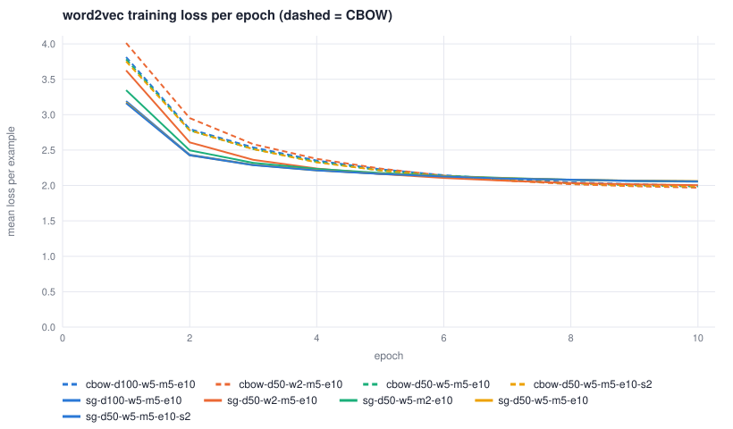
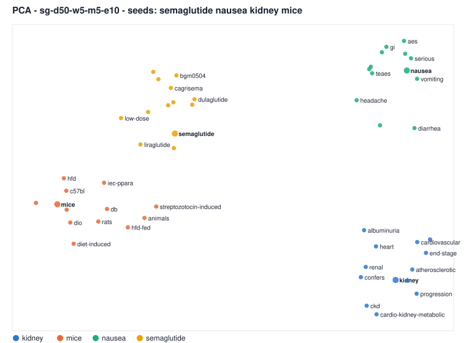
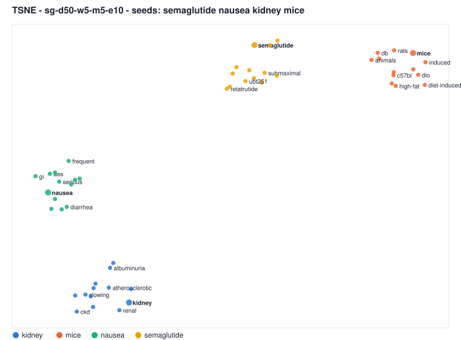

# Project #2 — Word Embedding：CBOW 與 Skip-gram

課程：Biomedical Information Retrieval（人工智慧資訊檢索）
作者：胡元楨（P77141105）
語料：1,000 篇 PubMed 摘要（查詢 *GLP-1*，`data/pubmed_glp1.jsonl`，與 Zipf 分析共用）
程式：`ir/word2vec.py`（CBOW / Skip-gram，negative sampling）、`ir/tsne.py`（PCA、t-SNE）、`ir/engine.py`（多模型管理、評估）、`static/w2v.js`（網頁 Word2Vec 分頁）。全部為純 Python 標準函式庫 + 原生 JavaScript，沒有 numpy、gensim、scikit-learn。

本報告的每個數字都可以在網頁的 **Word2Vec** 分頁（`python3 app.py` → http://127.0.0.1:8080/#w2v）或 `python3 cli.py w2v …` 重新算出；最後一節列出對應指令。

---

## 0. 核心問題

> 1,000 篇科學摘要這麼小的語料，能不能學到有意義的詞語意表示？

簡短的答案：**能學到「主題層級」的語意，但學不穩「詞層級」的細節。** 藥名、副作用、器官、動物模型各自成群，組內 cosine 明顯高於組間；但只出現 5–20 次的詞，其近鄰有一半以上由隨機初始化與抽樣順序決定（同設定換一個 seed，近鄰只剩四成重疊），而且兩種架構對同一個詞給出的近鄰只有 14% 重疊。下面依作業要求逐項說明。

---

## 1. 文字前處理

| 步驟 | 作法（`ir/word2vec.py: sentences_from_texts`） | 決定與理由 |
|---|---|---|
| 文件 | 每篇 = 標題 + 摘要 | 兩者都是作者寫的自然語句；標題獨立成一句（沒有句點，用換行切開） |
| 斷句 | Project #1 的規則式 EOS（縮寫、`E. coli`、小數、引號） | 視窗**不跨句**：句子是語意最小的完整單位，跨句的共現多半是雜訊 |
| 斷詞 | 正規表示式 `[A-Za-z][A-Za-z0-9]*(-[A-Za-z0-9]+)*` | 保留內部連字號（`glp-1`、`once-weekly`、`high-fat`、`c57bl`），因為在這個領域它們是一個詞；純數字（劑量、p 值、年份）丟棄 |
| 小寫化 | 全部小寫 | `Semaglutide` / `semaglutide` 是同一個詞；代價是 `WHO`→`who` 之類的歧義（本語料影響極小） |
| 標點 | 斷詞時直接略過 | 標點不進入視窗，也不佔位置 |
| 停用詞 | **移除**（Snowball 174 字 + 17 個生醫補充，與 Project #1 相同） | 見下 |
| 低頻詞 | **min_count = 5**（另外訓練一組 min_count = 2 比較） | 見下 |
| 詞幹 | **不做** | 詞嵌入要保留 `treat / treated / treatment` 各自的向量；之後第 8 節反過來用「同詞幹的變形是否互為近鄰」當評估指標 |

**為什麼移除停用詞。** 停用詞佔 252,025 個 token 中的 75,693 個（30.0%）。它們出現在幾乎每個視窗裡，對任何中心詞都提供不了鑑別資訊，卻會佔掉 dynamic window 內有限的位置，讓真正有關的詞被擠出視窗；對 CBOW 更糟，因為視窗平均會被 `the / of / in` 稀釋。word2vec 原始實作用 subsampling 壓低高頻詞，本實作兩者都做（subsampling 門檻 10⁻³）。

**為什麼 min_count = 5。** 下表是詞頻門檻與詞彙量 / 覆蓋率的關係（第 2 節的 Zipf 長尾）。出現不到 5 次的詞佔詞型的 69%，卻只佔 token 的 9.6%；它們的向量只會被更新寥寥數十次，學不出東西，反而拖長負樣本表與最近鄰搜尋。min_count = 2 的模型留作 RQ4 / RQ5 的對照。

---

## 2. 詞彙表

| 統計量 | 值 |
|---|---|
| 文件數 | 1,000 |
| 句子數 | 11,802（平均 14.94 個 token / 句，停用詞移除後） |
| Token 數（去停用詞後） | 176,332（去除前 252,025） |
| 詞型（types） | 14,517；其中 hapax（只出現一次）5,973 = 41.1% |
| 詞彙表（count ≥ 5） | **4,438** 個詞，涵蓋 90.4% 的 token |

| min_count | 保留詞型 | 詞型比例 | 涵蓋 token | token 比例 |
|---|---|---|---|---|
| ≥ 1 | 14,517 | 100% | 176,332 | 100% |
| ≥ 2 | 8,544 | 58.9% | 170,359 | 96.6% |
| ≥ 3 | 6,419 | 44.2% | 166,109 | 94.2% |
| **≥ 5** | **4,438** | **30.6%** | **159,413** | **90.4%** |
| ≥ 10 | 2,672 | 18.4% | 147,779 | 83.8% |
| ≥ 20 | 1,586 | 10.9% | 133,130 | 75.5% |
| ≥ 50 | 672 | 4.6% | 105,369 | 59.8% |

最高頻的 20 個詞：glp-1 1,931、receptor 1,520、patients 1,153、weight 1,134、obesity 1,121、diabetes 1,083、agonists 1,011、risk 994、glucagon-like 901、metabolic 873、outcomes 856、treatment 838、peptide-1 817、associated 783、study 782、clinical 774、ci 769、semaglutide 759、type 749、effects 721。榜首全是查詢主題本身（GLP-1 receptor agonists）與摘要的樣板詞（patients、outcomes、study、ci）——這對後面的分析很重要：**語料是單一主題**，所有文件都在講同一件事。

---

## 3. 訓練樣本的產生

視窗 ±w。對句子 `glp-1 receptor agonists reduce body weight adults obesity`（已前處理）、w = 2：

| 架構 | 樣本形式 | 這句產生的樣本 |
|---|---|---|
| Skip-gram | (input = 中心詞, target = 一個周圍詞) | 26 個配對：`glp-1→receptor`、`glp-1→agonists`、`receptor→glp-1`、`receptor→agonists`、`receptor→reduce`、… |
| CBOW | (input = 周圍詞集合的平均向量, target = 中心詞) | 8 個樣本：`{receptor, agonists}→glp-1`、`{glp-1, agonists, reduce}→receptor`、… |

訓練時每個位置的實際視窗 b 從 1..w 均勻抽出（Mikolov 的 dynamic window），所以離中心詞近的詞被取用的機率較高；每個樣本再配 k = 5 個負樣本（從 unigram^0.75 分布抽）。整個語料每個 epoch 的樣本數：

| window | Skip-gram 配對（固定 ±w） | Skip-gram 配對（dynamic 期望值） | CBOW 樣本 |
|---|---|---|---|
| ±2 | 566,868 | 431,047 | 159,405 |
| ±5 | 1,242,074 | **791,811** | **159,405** |
| ±10 | 1,945,428 | 1,247,051 | 159,405 |

CBOW 的樣本數永遠等於保留的 token 數；Skip-gram 是它的 2b 倍。網頁第 2 節可以輸入任何句子、調整視窗，並點某個詞只看該位置的樣本。

---

## 4. 模型訓練

### 4.1 實作

兩個權重矩陣：`syn0`（輸入 / 詞向量，即結果）與 `syn1`（輸出 / 上下文向量）。對輸入向量 h 與目標詞 t（label y = 1 為真實共現、0 為負樣本）：

```
g       = (y − σ(h · syn1[t])) × α
syn1[t] += g × h
h       += Σ_targets g × syn1[t]      （Skip-gram：加回中心詞；CBOW：平均分給視窗內每個詞）
loss    = −log σ(h·v_target) − Σ_k log σ(−h·v_neg)
```

學習率 α 從 0.025 線性遞減；sigmoid 查表；同一個 seed 的訓練完全可重現。

### 4.2 超參數與訓練記錄

共訓練 9 個模型，都是 10 epochs、negative = 5、subsampling 10⁻³、停用詞移除，存在 `data/w2v/`：

| 模型 | 架構 | dim | window | min_count | seed | 詞彙 | 樣本 / epoch | 最終 loss | 訓練時間 |
|---|---|---|---|---|---|---|---|---|---|
| **sg-d50-w5-m5-e10**（基準） | Skip-gram | 50 | 5 | 5 | 1 | 4,438 | 791,811 | 2.062 | 254.7 s |
| **cbow-d50-w5-m5-e10**（基準） | CBOW | 50 | 5 | 5 | 1 | 4,438 | 159,405 | 1.985 | 82.5 s |
| sg-d50-w2-m5-e10 | Skip-gram | 50 | 2 | 5 | 1 | 4,438 | 431,047 | 2.005 | 150.1 s |
| cbow-d50-w2-m5-e10 | CBOW | 50 | 2 | 5 | 1 | 4,438 | 159,405 | 1.969 | 75.7 s |
| sg-d100-w5-m5-e10 | Skip-gram | 100 | 5 | 5 | 1 | 4,438 | 791,811 | 2.053 | 474.8 s |
| cbow-d100-w5-m5-e10 | CBOW | 100 | 5 | 5 | 1 | 4,438 | 159,405 | 1.998 | 159.6 s |
| sg-d50-w5-m2-e10 | Skip-gram | 50 | 5 | 2 | 1 | 8,544 | 857,252 | 2.057 | 297.8 s |
| sg-d50-w5-m5-e10-s2 | Skip-gram | 50 | 5 | 5 | 2 | 4,438 | 791,811 | 2.059 | 252.9 s |
| cbow-d50-w5-m5-e10-s2 | CBOW | 50 | 5 | 5 | 2 | 4,438 | 159,405 | 1.988 | 79.4 s |

訓練損失（每個 epoch 的平均 negative-sampling loss）：

| epoch | 1 | 2 | 3 | 4 | 5 | 6 | 7 | 8 | 9 | 10 |
|---|---|---|---|---|---|---|---|---|---|---|
| Skip-gram 基準 | 3.173 | 2.428 | 2.289 | 2.213 | 2.166 | 2.129 | 2.101 | 2.081 | 2.069 | 2.062 |
| CBOW 基準 | 3.781 | 2.779 | 2.515 | 2.335 | 2.213 | 2.130 | 2.073 | 2.032 | 2.002 | 1.985 |



兩者都在 10 個 epoch 內收斂（最後兩個 epoch 的差 < 0.02）。Skip-gram 第 1 個 epoch 就降得多（它一個 epoch 看了 5 倍的樣本），CBOW 起點高、最後反而較低——因為 CBOW 預測的是「給定整個視窗的平均，中心詞是什麼」，比 Skip-gram 的「給定一個詞，兩格外的某個詞是什麼」容易，所以 **loss 的絕對值不能跨架構比較**，只能看各自是否收斂。window 2 的 loss 比 window 5 低，同理：近的詞比遠的詞好預測。

---

## 5. 詞彙相似度分析（RQ2 的證據之一）

餘弦相似度 cos(u, v) = u·v / (|u||v|)。14 個詞、兩個基準模型各列前 5 名；**粗體**是兩個模型共同的近鄰，最後一欄是兩組近鄰的 Jaccard 重疊。

| 詞（次數） | Skip-gram 基準 | CBOW 基準 | 重疊 |
|---|---|---|---|
| semaglutide (759) | **dulaglutide** .79, submaximal .76, **liraglutide** .74, low-dose .73, bgm0504 .73 | tirzepatide .92, **liraglutide** .92, once-weekly .92, orforglipron .92, **dulaglutide** .90 | 0.25 |
| tirzepatide (446) | cagrisema .73, **dulaglutide** .73, exenatide .71, **semaglutide** .70, **once-weekly** .70 | **semaglutide** .92, **once-weekly** .85, **dulaglutide** .85, liraglutide .84, orforglipron .84 | 0.43 |
| liraglutide (218) | **dulaglutide** .84, **exenatide** .79, sinomenine .76, lira .75, **semaglutide** .74 | **dulaglutide** .96, **exenatide** .92, **semaglutide** .92, retatrutide .89, subcutaneous .88 | 0.43 |
| nausea (32) | **vomiting** .97, serious .94, diarrhea .93, constipation .92, aes .91 | **vomiting** .98, hcc .97, thromboembolic .97, thromboembolism .97, decompensation .97 | 0.11 |
| obesity (1,121) | childhood .71, resistant .69, obstructive .69, complicated .69, manage .69 | overweight .93, revolutionized .92, t1d .92, mellitus .91, individuals .91 | 0.00 |
| weight (1,134) | loss .80, achieve .76, **achieving** .73, attributable .73, producing .73 | substantial .78, **achieving** .77, contouring .77, meaningful .76, rapid .76 | 0.11 |
| diabetes (1,083) | prediabetes .78, **mellitus** .77, resistant .73, living .73, outpatients .72 | t2dm .82, t2d .81, individuals .81, people .81, **mellitus** .81 | 0.11 |
| insulin (451) | resistance .61, beta-cell .60, **basal** .59, **glargine** .58, proinsulin .58 | **basal** .88, c-peptide .84, infusion .83, **glargine** .83, glucose .82 | 0.25 |
| kidney (378) | **atherosclerotic** .71, **progression** .71, cardiovascular .71, slowing .70, renal .69 | alzheimer .91, **atherosclerotic** .90, **progression** .90, gallbladder .89, artery .88 | 0.25 |
| cardiovascular (563) | **atherosclerotic** .80, **cerebrovascular** .77, cv .74, cardiorenal .74, predicting .74 | **atherosclerotic** .89, major .89, cvd .87, **cerebrovascular** .87, psychiatric .86 | 0.25 |
| mice (174) | rats .85, **induced** .84, dio .84, **db** .82, c57bl .82 | **db** .89, plasma .89, high-fat .89, c-reactive .88, **induced** .88 | 0.25 |
| cancer (135) | breast .83, pdac .81, colorectal .80, cancers .78, crc .77 | ischemic .88, optic .86, foot .86, neuropathy .86, macular .85 | 0.00 |
| treatment (838) | variable .65, **discontinuation** .63, treatments .63, mandated .62, cost-effective .61 | maintenance .86, adjunct .83, lifestyle .82, **discontinuation** .80, tirzepatide .79 | 0.11 |
| diagnosis (68) | codes .86, residents .82, classified .79, earlier .79, cabg .79 | newly .96, documented .95, diagnosed .93, ibd .92, t1dm .92 | 0.00 |

讀法：

* **藥名**（semaglutide / tirzepatide / liraglutide）在兩個模型都互為近鄰，還帶出 dulaglutide、exenatide、orforglipron、retatrutide、cagrisema、survodutide 這些同類藥——這是「同一個句法位置可互換」的分布相似性，兩種架構都抓得到。
* **副作用**：nausea → vomiting（0.97 / 0.98）、diarrhea、constipation；Skip-gram 的其餘近鄰（serious、aes = adverse events）仍在副作用語境裡，CBOW 卻給了 hcc、thromboembolic、decompensation——它們和 nausea 同樣出現在「…的風險 / 事件」的句型中，CBOW 把**句型**學得比**語意**重。
* **cancer**：Skip-gram 給 breast、pdac、colorectal、crc（癌症種類），CBOW 給 ischemic、optic、foot、neuropathy、macular（糖尿病併發症）。cancer 只出現 135 次，Skip-gram 對這種中低頻、主題明確的詞明顯較好（RQ1）。
* **高頻一般詞**（obesity、weight、treatment、diagnosis）的近鄰最差也最不一致（重疊 0–0.11）：它們出現在太多不同語境，50 維的單一向量把所有語境平均掉了。
* CBOW 的 cosine 數值普遍比 Skip-gram 高（0.9 對 0.7），**不代表它學得更好**——第 6 節顯示 CBOW 隨機詞對的 cosine 也有 0.63，整個空間擠在一個錐體裡（anisotropy）。

類比運算（v(b) − v(a) + v(c)）在 Skip-gram 基準上的例子：kidney : ckd = liver : **non-alcoholic / masld / mafld / steatotic**（都是脂肪肝的名稱）；obesity : weight = diabetes : **glycaemic / glycemic**。CBOW 的同樣類比得到 pwh、comorbidities、women，不成立。類比需要「關係向量」在不同詞對間一致，小語料只有反覆出現的器官—疾病關係學得出來。

---

## 6. 詞嵌入是否具有語意意義？（RQ2）

挑 6 組、22 個相關詞（藥名 / 副作用 / 體重 / 血糖 / 腎臟 / 動物模型），計算所有詞對的 cosine，看組內是否高於組間；基準線是整個詞彙表隨機抽 400 對的平均。

| 模型 | 組內平均 | 組間平均 | 隨機詞對平均 | 各組組內平均（藥名 / 副作用 / 體重 / 血糖 / 腎臟 / 動物） |
|---|---|---|---|---|
| Skip-gram 基準 | **0.680** | 0.350 | 0.474 | 0.75 / 0.95 / 0.57 / 0.43 / 0.61 / 0.74 |
| CBOW 基準 | **0.702** | 0.348 | 0.633 | 0.90 / 0.95 / 0.65 / 0.37 / 0.59 / 0.75 |
| Skip-gram window 2 | 0.699 | 0.407 | 0.608 | 0.84 / 0.94 / 0.60 / 0.46 / 0.58 / 0.75 |
| CBOW window 2 | 0.702 | 0.424 | 0.738 | 0.92 / 0.92 / 0.68 / 0.34 / 0.60 / 0.76 |
| Skip-gram 100 維 | 0.659 | 0.329 | 0.475 | 0.68 / 0.95 / 0.54 / 0.42 / 0.63 / 0.71 |

判讀：

1. **組內 ≫ 組間**（0.68 對 0.35），且每一組的組內平均都高於組間平均——模型確實把相關詞放在一起，不是巧合。
2. **組間平均低於隨機詞對**（0.35 < 0.47）：這些組是語料中最鮮明的六個主題，彼此被推得比一般詞對更開，是語意結構的正面證據。
3. **「隨機詞對 0.47–0.74」本身是警訊**：向量空間高度各向異性，所有詞共享一個主方向。CBOW 更嚴重（0.63），因為它用視窗平均當輸入，所有輸出向量都被推向「平均視窗」的方向。所以**不能看 cosine 的絕對值**，要看相對排序或與基準線的差。
4. **最弱的一組是血糖**（diabetes / hba1c / glucose / insulin：0.43 與 0.37）：diabetes–insulin 只有 0.30，diabetes–glucose 在 CBOW 甚至 −0.03。這四個詞在摘要裡的句法角色不同（diabetes 是病名、hba1c 是量測值、insulin 是藥物 / 荷爾蒙），分布相似性不等於概念相關性——word2vec 學的是「可以互換的詞」，不是「有關的詞」。
5. **跨組最相近的詞對**反而很合理：bmi–hba1c 0.78（都是量測指標）、obesity–diabetes 0.66、liraglutide–mice 0.65（動物實驗最常用的 GLP-1 藥）。
6. 作業建議的 cancer / tumor / treatment / diagnosis：cancer–tumor 0.37（Skip-gram）/ 0.27（CBOW）——tumor 只出現 19 次，學不穩；treatment–therapy 0.54 / 0.63；diagnosis–diagnosed 0.77 / 0.93。本語料是 GLP-1 主題，腫瘤學詞彙本來就少，這正是 RQ5 的「語料領域」限制。

---

## 7. 視覺化：PCA 與 t-SNE（RQ3）

同一組 52 個詞（4 個種子 semaglutide / nausea / kidney / mice 各加 12 個最近鄰）、同一個 Skip-gram 基準模型：

| | PCA | t-SNE（perplexity 15、400 iterations） |
|---|---|---|
| 方法 | 線性：投影到變異最大的兩個正交方向（power iteration） | 非線性：高維鄰居機率 P（高斯核、每點依 perplexity 調頻寬）對低維 Q（Student-t 核），梯度下降最小化 KL(P‖Q)，含 early exaggeration、momentum、adaptive gains |
| 保留的資訊 | PC1 34.6% + PC2 19.1% = **53.7%** 的變異 | 最終 KL = 0.054 |
| k-NN 保留率 k = 5 / 10 | **50.8% / 83.1%** | **81.5% / 89.0%** |
| 最常見 120 個詞（無種子） | 25.8% / 33.3%（PC1+PC2 只佔 15.4% 變異） | 60.3% / 53.8% |




（CBOW 基準的對應圖：`report/w2v_pca_cbow.svg`、`report/w2v_tsne_cbow.svg`；PCA 保留 56.5% / 85.8%，t-SNE 80.4% / 91.9%。）

觀察與結論：

* **四群在兩張圖都分得開**——因為這四個種子本來就是語料中距離很遠的主題。PCA 裡藥名群與動物模型群靠得近、副作用群在對角；t-SNE 把四群拉成四個緊密的島。
* **PCA 的優點是座標有意義**：PC1 大致是「臨床試驗 / 藥物」對「動物實驗 / 機制」的軸，兩點的距離是真實距離的線性投影；缺點是 50 維只剩 53.7% 的變異，群內的細節被壓扁（k = 5 的鄰域只保留一半），而在沒有挑選種子的 120 個高頻詞上，兩個主成分只解釋 15% 的變異，圖幾乎沒有結構。
* **t-SNE 的優點是局部鄰域忠實**（81.5% / 89.0%），缺點是**群與群之間的距離、群的大小、群內點的相對方位都沒有意義**：換 perplexity 5 / 30 或換 seed 會得到不同的佈局（k-NN 保留率 76.5%–81.5%），KL 也隨 perplexity 單調下降（0.162 → 0.054 → 0.050），不能拿來比較圖的好壞。
* **視覺上成群 ≠ 語意好。** t-SNE 對完全隨機的向量也會畫出一團團「群」（它的目標函數就是把鄰居湊在一起）。本報告因此另外量化：第 6 節的 cosine 矩陣（組內 / 組間 / 隨機基準）與第 8 節的指標，才是判斷模型語意能力的依據；兩張圖只是幫助看出「哪些詞被模型視為鄰居」。

---

## 8. 參數影響、低頻詞與穩定度（RQ1、RQ4、RQ5 的量化證據）

沒有外部標準答案（本領域沒有現成的相似度測試集），因此設計三個**內在**指標，對每個詞頻分桶各抽 120 個詞：

* **sim@10**：前 10 個近鄰的平均 cosine。越高表示鄰域越「緊」——但對罕見詞，過高反而是訊號不足的徵兆（見下）。
* **近鄰頻次中位數**：近鄰的出現次數中位數。罕見詞的鄰居是罕見詞還是常見詞？
* **變形命中率 hit@10 / MRR**：詞彙表中有 737 組、1,947 個詞共享同一個 Porter 詞幹（patient / patients、treat / treated / treatment、trial / trials）。一個好的嵌入應把這些變形放在一起。只計算有變形存在的詞。
* **近鄰重疊率**：兩個模型對同一個詞的前 10 近鄰的 Jaccard。同設定、不同 seed 的重疊率就是「穩定度」。

### 8.1 CBOW vs Skip-gram（基準，50 維、window 5）

| 詞頻分桶（詞數） | 5–9 (1,766) | 10–19 (1,086) | 20–49 (914) | 50–199 (549) | 200+ (123) |
|---|---|---|---|---|---|
| sim@10 — CBOW | 0.971 | 0.966 | 0.955 | 0.914 | 0.864 |
| sim@10 — Skip-gram | 0.925 | 0.895 | 0.867 | 0.810 | 0.736 |
| 近鄰頻次中位數 — CBOW | 9 | 11 | 18 | 49 | 78 |
| 近鄰頻次中位數 — Skip-gram | 7 | 8 | 10 | 13 | 20 |
| 變形 hit@10 — CBOW | **0.0%** | 6.6% | 12.5% | 18.9% | 30.5% |
| 變形 hit@10 — Skip-gram | **6.1%** | 11.5% | 16.1% | 17.6% | 28.1% |
| 變形 MRR — CBOW | 0.000 | 0.026 | 0.028 | 0.072 | 0.162 |
| 變形 MRR — Skip-gram | 0.007 | 0.051 | 0.042 | 0.088 | 0.186 |
| 近鄰重疊率 SG vs CBOW | 10.7% | 13.3% | 14.8% | 13.1% | 18.5% |

* **罕見詞的 sim@10 高達 0.93–0.97**：出現 5–9 次的詞只被更新幾十次，向量離初始值不遠，彼此之間自然很像（它們都還在原點附近的同一個方向上）。這不是學到了什麼，而是**沒學到東西**的表現。
* **Skip-gram 在 5–49 次的分桶變形命中率是 CBOW 的 1.3–∞ 倍**（6.1% 對 0.0%、11.5% 對 6.6%、16.1% 對 12.5%）；200+ 的高頻詞兩者差不多甚至 CBOW 略好。這正是理論預期：Skip-gram 讓罕見詞的向量每出現一次就更新 2b 次，CBOW 只分到平均梯度的 1/2b。
* **兩個架構的近鄰只有 14% 重疊**：同一份語料、同樣的視窗，學到的「相似」定義不同（CBOW 偏句型，Skip-gram 偏主題，第 5 節的 nausea / cancer 例子）。

### 8.2 參數比較（RQ4）

| 比較 | 近鄰重疊率（整體） | 5–9 | 200+ | 觀察 |
|---|---|---|---|---|
| SG window 5 vs window 2 | 24.4% | 14.5% | 36.7% | 視窗影響很大。window 2 的近鄰更「句法」：weight → hair、antipsychotic-induced、body-weight（weight 前後緊鄰的詞）；window 5 → loss、achieve、attributable（主題）。semaglutide 在 window 2 得到更多藥名（survodutide、ecnoglutide、tirzepatide），因為藥名最常出現在「A vs B」「A, B and C」的緊鄰位置 |
| CBOW window 5 vs window 2 | 21.6% | 7.0% | 43.2% | 同上，對罕見詞影響更大 |
| SG 50 維 vs 100 維 | 50.3% | 44.0% | 58.1% | 維度影響最小。100 維的 sim@10 幾乎不變、變形命中率 5–9 桶略升（6.1% → 9.1%），但訓練時間加倍（255 s → 475 s），cosine 整體下降（組內 0.68 → 0.66），因為 100 維有更多自由度去區分詞——對 4,438 個詞、16 萬 token，50 維已經夠用 |
| CBOW 50 維 vs 100 維 | 36.6% | 16.1% | 61.0% | CBOW 對維度較敏感，特別是罕見詞 |
| SG min_count 5 vs 2 | 36.3% | 18.1% | 49.6% | min_count 2 詞彙 4,438 → 8,544，多出的 4,106 個詞只出現 1–4 次：它們的 sim@10 = 0.967、近鄰頻次中位數 2——罕見詞全擠在一起互為近鄰，還會「污染」原本詞的近鄰（kidney 的近鄰出現 iec-ppara 這類只出現幾次的基因名）。好處是 5–9 桶的變形命中率反而升到 13%（多了更多變形可命中） |
| SG seed 1 vs seed 2 | **48.6%** | 41.7% | 53.9% | 見 8.3 |
| CBOW seed 1 vs seed 2 | **36.7%** | 16.6% | 59.8% | 見 8.3 |

視覺化上，window 2 與 window 5 的 t-SNE 圖四群都分得開，差別在群**內**的成員：window 2 的 semaglutide 群更純（全是藥名），window 5 混入 once-weekly、subcutaneous、low-dose（劑量 / 給藥方式）。

### 8.3 小型語料的限制（RQ5）

**穩定度是最直接的證據。** 同一份語料、同樣的超參數，只換隨機種子（初始化、句子順序、負樣本、dynamic window 的抽樣），Skip-gram 對同一個詞的前 10 近鄰只有 **48.6%** 重疊，CBOW 只有 **36.7%**；對出現 5–9 次的詞分別只剩 41.7% 與 **16.6%**。換句話說，在這個語料上「某個罕見詞的近鄰是誰」有一半以上是雜訊。相對地，200+ 次的高頻詞重疊率 54–60%，高頻詞穩定得多但也遠非完全穩定。

具體的限制與原因：

1. **低頻詞**：41% 的詞型只出現一次、69% 不到 5 次（Zipf 長尾）。min_count = 5 已經丟掉七成的詞型；留下的 4,438 個詞中仍有 40%（1,766 個）只出現 5–9 次，其向量基本上沒有離開初始化（sim@10 0.93–0.97、重疊率 17–42%）。
2. **專業術語**：tumor（19 次）、nafld（10 次）、retinopathy（18 次）、parkinson（12 次）都在不穩定區；藥名是例外（semaglutide 759 次、tirzepatide 446 次）——因為語料就是用 GLP-1 查出來的。要穩定學到一個術語，經驗上需要數百次出現；1,000 篇摘要只有 123 個詞超過 200 次。
3. **語料領域**：單一主題讓「同主題」失去鑑別力——所有文件都在講 GLP-1、肥胖、糖尿病，所以 obesity 與 diabetes 的 cosine（0.66）比 diabetes 與 insulin（0.30）還高；向量空間各向異性嚴重（隨機詞對 cosine 0.47–0.74）。腫瘤學、神經科的詞不是沒有，而是以「GLP-1 對 X 的影響」的樣板句出現，所以 cancer 的 CBOW 近鄰變成糖尿病併發症。另一方面，領域單一也是優點：沒有一詞多義（`cold`、`bank`）的問題，摘要的句法規整，才能在 16 萬 token 上學出第 6 節的六個群。
4. **資料量**：Mikolov 的原始實驗用 10⁹ 個 token；本語料 1.8 × 10⁵，少四個數量級。loss 曲線在 10 個 epoch 收斂不是因為學完了，而是因為能從這麼少的樣本擠出的資訊就這麼多——多跑 epoch 只會更貼合這 1,000 篇的措辭。
5. **能做什麼**：這種規模的嵌入適合「主題層級」的用途——查詢擴展（semaglutide → dulaglutide / liraglutide）、副作用詞群、同義縮寫（t2dm / t2d / mellitus）、用 PCA / t-SNE 探索語料主題；不適合需要詞層級精度的用途（類比推理、罕見術語的相似度）。改善方向：在大型生醫語料（PubMed 全庫、PMC OA）預訓練再用本語料微調；或用子詞 / 字元 n-gram（fastText）讓 `glp-1ra`、`glp-1ras`、`glp-1r` 共享參數；或改用上下文嵌入。

---

## 9. CBOW vs Skip-gram 比較表（RQ1）

| Property | CBOW | Skip-gram |
|---|---|---|
| **Input** | 視窗內 2b 個周圍詞向量的**平均**（bag of words，不分順序） | **一個中心詞**的向量 |
| **Prediction target** | 中心詞 | 視窗內的**每一個**周圍詞（各自一個配對） |
| **Training examples** | 每個位置 1 個 ≈ token 數（本語料 159,405 / epoch） | 每個位置 2b 個 ≈ token 數 × 平均視窗（window 5 dynamic：791,811 / epoch，5 倍） |
| **Training speed** | 快：10 epochs 82.5 s | 慢：10 epochs 254.7 s（約 3 倍；100 維 475 s） |
| **Training loss** | 起點高（3.78）、終點低（1.985）：預測「平均視窗 → 中心詞」較容易 | 起點低（3.17）、終點高（2.062）：每個配對獨立預測較難。兩者不可直接比較 |
| **Nearest neighbours** | cosine 絕對值高（0.85–0.95），偏**句型 / 位置**相似（nausea → hcc、thromboembolic；cancer → neuropathy、macular） | cosine 較低（0.6–0.85），偏**主題**相似（nausea → vomiting、diarrhea、aes；cancer → breast、colorectal、pdac） |
| **Rare words** | 差：5–9 次的詞變形命中率 0%，seed 間重疊 16.6%；罕見詞只分到平均梯度的 1/2b，且被同視窗的高頻詞稀釋 | 較好：5–9 次的詞變形命中率 6.1%，seed 間重疊 41.7%；每出現一次自身向量就更新 2b 次 |
| **Expected behavior** | 高頻詞穩定（200+ 桶變形命中 30.5%）；大語料下與 Skip-gram 相近；適合速度優先 | 小語料、專有名詞、主題式相似度較佳；對 window 敏感；類比運算在本語料只有 Skip-gram 成立 |

**為什麼 Skip-gram 對罕見或領域專有的科學術語特別有用？**

1. **更新次數**：Skip-gram 把罕見詞的每一次出現拆成 2b 個獨立的訓練配對（window 5 平均 6 個），每個配對都直接對這個詞的向量做梯度更新，並各帶 k = 5 個負樣本。一個只出現 8 次的基因名在 10 個 epoch 裡被更新約 8 × 6 × 10 = 480 次；在 CBOW 裡它只以「視窗平均的 1/2b」的身分參與 80 次更新，而且每次的梯度都被同視窗的 patients、treatment 等高頻詞分走。
2. **不被平均稀釋**：CBOW 的輸入是視窗平均，罕見術語和高頻詞混在同一個 h 裡，模型可以只靠高頻詞就把中心詞猜對，罕見詞的向量得不到有鑑別力的訊號；Skip-gram 的輸入只有這一個詞，它必須自己解釋整個視窗。
3. **科學術語的分布特性**：藥名、基因、量表縮寫往往出現在固定的句型裡（「treated with X」「X-induced」「X vs Y」），這種「同一位置可互換」的訊號在 Skip-gram 的逐對預測中保存得最好（第 5 節的藥名群、第 8.2 節 window 2 的結果）。
4. **代價**：樣本數多 2b 倍、訓練時間約 3 倍；對高頻詞沒有優勢（200+ 桶兩者相當）。Mikolov 等人（2013）的結論也是：Skip-gram 在小資料與罕見詞上較好，CBOW 快且在大資料上的句法任務略勝。本語料的量測與之一致。

---

## 10. 重現方式

```bash
python3 app.py                     # 網頁：http://127.0.0.1:8080/#w2v（第 1–8 節一一對應）
python3 cli.py w2v vocab           # 第 1–3 節：前處理、詞彙表、樣本數
python3 cli.py w2v examples "GLP-1 receptor agonists reduce body weight in adults with obesity" --window 2
python3 cli.py w2v train --model sg --dim 50 --window 5 --epochs 10        # 第 4 節（約 4 分鐘）
python3 cli.py w2v train --model cbow --dim 50 --window 5 --epochs 10      # （約 1.5 分鐘）
python3 cli.py w2v train --model sg --window 2 ; python3 cli.py w2v train --model sg --dim 100
python3 cli.py w2v train --model sg --min-count 2 ; python3 cli.py w2v train --model sg --seed 2
python3 cli.py w2v list
python3 cli.py w2v compare semaglutide tirzepatide liraglutide nausea obesity weight diabetes insulin kidney cardiovascular mice cancer treatment diagnosis --models sg-d50-w5-m5-e10,cbow-d50-w5-m5-e10
python3 cli.py w2v pairs "semaglutide,liraglutide,dulaglutide,tirzepatide; nausea,vomiting,diarrhea,constipation; obesity,overweight,bmi; diabetes,hba1c,glucose,insulin; kidney,renal,ckd,egfr; mice,rats,mouse"
python3 cli.py w2v map semaglutide nausea kidney mice --method pca --svg report/
python3 cli.py w2v map semaglutide nausea kidney mice --method tsne --svg report/
python3 cli.py w2v eval --models sg-d50-w5-m5-e10,cbow-d50-w5-m5-e10
python3 cli.py w2v overlap --models sg-d50-w5-m5-e10,sg-d50-w5-m5-e10-s2
python3 -m unittest discover -s tests -v
```

網頁的「Queue comparison set」按鈕會把第 4.2 節的 9 組設定排進訓練佇列（純 Python 約 30 分鐘）。
